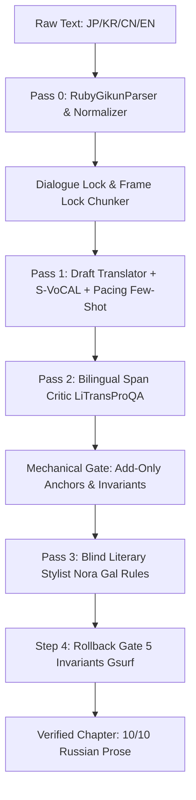

# Architecture Blueprint: Autonomous Web-Novel Translation Studio (EGM Hay)

## System Overview
Автономная студия литературного перевода длинных веб-новелл (JP/CN/KR/EN → RU) представляет собой 4-фазную систему машинного перевода следующего поколения. В основе лежит архитектурная изоляция **Source Firewall** (WMT 2026 / EAMT 2024), которая исключает «синтаксический гипноз оригинала» (*shining-through effect*) при сохранении 100% фактологической и терминологической точности.

## Subsystems & Component Boundaries
- [`lib/`](file:///c:/Users/vanya/Desktop/автономная-студия-перевода-веб-новелл/lib/README.md): Ядро лингвистической обработки, детерминированный QA-линтер (20 правил), AST-препроцессоры CJK, адаптеры инференса и шлюзы отката.
- [`components/`](file:///c:/Users/vanya/Desktop/автономная-студия-перевода-веб-новелл/components/README.md): Реактивный интерфейс Next.js 15: параллельный редактор с Zen-режимом, 3-шаговый онбординг-мастер, хранилище канона и экспорт для Рулейта.
- [`app/api/`](file:///c:/Users/vanya/Desktop/автономная-студия-перевода-веб-новелл/app/api/README.md): Серверные роуты инференса (`/api/pipeline`) и управления проектами (`/api/projects`).

## Global Invariants
1. **Source Firewall Invariant**: Текст оригинала $x_s$ никогда не попадает в контекстное окно `Pass 3 (Blind Literary Stylist)`. Стилист видит только выверенный русский текст $y'$ и точечные директивы ($\le 3$ на абзац).
2. **Surface Invariants ($G_{surf}$)**: Ни один абзац с искаженными числами, стёртыми каноническими терминами глоссария или сломанным балансом скобок/кавычек не может попасть в финальный текст; шлюз `verifyAndRollbackStylistPass` выполняет мгновенный поабзацный откат.
3. **No Heavy Python in Frontend Runtime**: Все парсеры (фуригана, CJK-склонения, 20 правил линтера) работают на чистом TypeScript со временем выполнения полного тестового набора $\le 1.5$ с.
4. **Data Continuity**: Сериализация проектов версионируется (v2.5 / v4.1), а экспорт на Рулейт строго формирует Unix LF и 2-параметрические заголовки.

## Verification
- Unit & Integration Test Suite: `node --test lib/qa-linter.test.ts` (55 tests)
- Static Analysis: `npx tsc --noEmit` & `npm run lint`
- Production Build: `npm run build`
