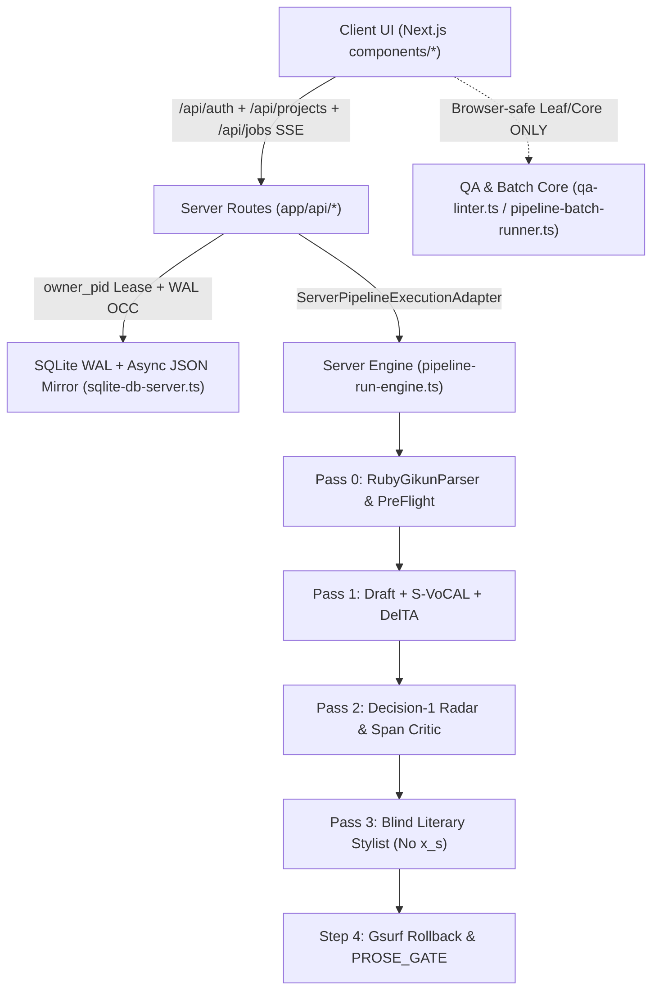

# Architecture Blueprint: Autonomous Web-Novel Translation Studio

## System Overview
Автономная студия литературного перевода длинных веб-новелл (JP/CN/KR/EN → RU) представляет собой 4-фазный многоагентный конвейер с архитектурной изоляцией **Source Firewall** (WMT 2026 / EAMT 2024), серверной БД `SQLite WAL`, фоновым SSE-брокером задач и детерминированной верификацией по 20 правилам русского слога.

## Subsystems & Component Boundaries
- [`lib/`](../../lib/README.md): Строгий ациклический граф (0 циклических импортов). Браузерно-безопасные листья (`pipeline-types.ts`, `russian-morphology.ts`, `scene-analysis.ts`, `qa-linter.ts`, `pipeline-batch-runner.ts`) полностью отделены от серверных модулей (`llm-inference-port.ts`, `pipeline-run-engine.ts`, `chapter-verifier-server.ts`, `sqlite-db-server.ts`, `job-broker.ts`, `api-security.ts`).
- [`components/`](../../components/README.md): Реактивный интерфейс (`PipelineStudioApp`, `StudioAuthGate`, `components/studio/*`, `components/editor/*`) с инкрементальным SSE-обновлением глав и ленивым графиком `TranslationAnalyticsChart`. Клиентский бандл гарантированно не содержит серверных SDK и адаптеров.
- [`app/api/`](../../app/api/README.md): Серверные роуты аутентификации (`/api/auth`), инференса (`/api/pipeline`), CRUD/OCC (`/api/projects`) и SSE-задач (`/api/jobs`).

## Global Invariants
1. **Zero-Cycle DAG & Bundle Isolation**: В `lib/` поддерживается 0 циклических runtime-зависимостей; клиентские чанки `.next/static/chunks/*` не содержат `@google/genai`, `node:sqlite`, `llm-inference-port`, `gemini-decision-engine` и CLI-обвязки.
2. **Source Firewall & Surface Invariants ($G_{surf}$)**: Текст оригинала $x_s$ не попадает в контекст `Pass 3 (Blind Stylist)`, а любой абзац с нарушением чисел, глоссария, скобок или длины $> \pm 45\%$ откатывается шлюзом `verifyAndRollbackStylistPass`.
3. **Persistence, Concurrency & Process Lease**: `StudioSqliteDatabase` (`node:sqlite` WAL) использует поглавный OCC (`revision`), сериализованную отложенную запись `data/novels_db.json` (с обязательным flush в `close()`) и таблицу `pipeline_jobs.owner_pid`, блокирующую одновременный запуск CLI/SSE-задач над одной новеллой (`409 Conflict`).
4. **Fail-Closed Outages & Explicit Degradation**: Сбой Pass 1 переводит главу в карантин без затирания прежнего текста; частичные деградации Pass 2/3 или Decision 1 пробрасываются в `degradedWarnings`.

## Verification
- Test suite: `npm test` (`lib/qa-linter.test.ts` + `lib/audit-fixes.test.ts`)
- Typecheck & Lint: `npx tsc --noEmit && npm run lint`
- Production Build: `npm run build`
- Corpus Gate: `node scripts/forensic-novel-audit.ts --novel <novel-slug> --range 1-50 --gate`
