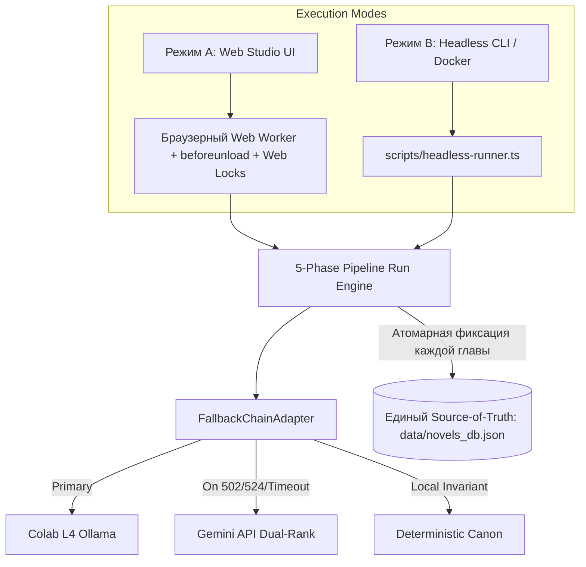

# Approved Design Specification: V4 Production Hardening & Autonomous Batch Runner (EGM Resolved)

## 1. Problem Statement & Motivation
Текущая версия студии перевода (8.5/10) обладает эталонным 4-проходным лингвистическим ядром со Source Firewall, но имеет два эксплуатационных риска:
1. **Прерывание длинных сессий при закрытии вкладки или троттлинге браузера**: При переводе 30–50 глав вкладка браузера может быть случайно закрыта или затроттлена операционной системой в фоновом режиме.
2. **Нестабильность туннелей бесплатного Google Colab L4**: Туннели Cloudflare могут отвечать HTTP 502/524/530 при засыпании блокнота.

## 2. EGM Resolution: Pruning Over-Engineering (YAGNI & Architecture Audit)
По результатам аудита субагентами **`egm-design` (Hostile Design Critic)** и **`egm-zoom-out` (Skeptical Architect)**:
- **Отклонено (Over-Engineering & C++ Bloat)**: Внешние очереди `BullMQ`/`Redis`, нативные аддоны `better-sqlite3` (ломающие сборку на Windows и Alpine Linux), и дублирующие базы `SQLite Task DB`, создающие split-brain с `data/novels_db.json`.
- **Принято (Clean TypeScript & Zero Native Dependencies)**:
  1. **Режим Web Studio (Браузер)**: Выделенный браузерный `Web Worker` + `beforeunload` гарда от закрытия вкладки + `navigator.locks` + атомарная запись каждой главы в IndexedDB и `data/novels_db.json`. При повторном открытии — моментальная кнопка «Возобновить с главы $N$».
  2. **Режим Headless Overnight Runner (Сервер / Docker)**: Автономный легковесный TypeScript-раннер (`scripts/headless-runner.ts` / `npm run batch`) на чистом Node.js, который исполняет пакет в терминале или контейнере Docker без запущенного браузера, обновляя `data/novels_db.json` атомарно (`tmp -> rename`).
  3. **Последовательный контекст (Sequential Narrative Invariant)**: Главы строго исполняются как упорядоченный контекстный граф (передача краткого содержания DelTA $N-1 \to N$, обновление Живого Паспорта Героя и канонического глоссария).
  4. **Реактивный Fallback вместо опросного демона**: Использование существующего [`FallbackChainAdapter`](file:///c:/Users/vanya/Desktop/автономная-студия-перевода-веб-новелл/lib/llm-inference-port.ts) для перехвата кодов 502/524/530/timeout с откатом на границе главы.



## 3. Detailed Component Design

### 3.1 Unbreakable Browser Session Guard
- **`beforeunload` Hook**: При активном флаге `isRunningPipeline` попытка закрыть вкладку вызывает системное предупреждение («Идёт пакетный перевод новеллы. Несохранённые главы могут прерваться»).
- **Idempotent Batch Resume**: Поскольку [`runPipelineBatchOnNovel`](file:///c:/Users/vanya/Desktop/автономная-студия-перевода-веб-новелл/lib/pipeline-run-engine.ts) сохраняет каждую завершённую главу на диск и в IndexedDB сразу по завершении, при открытии страницы студия автоматически детектирует статус последней переведённой главы и предлагает продолжить пакет в один клик.

### 3.2 Headless Overnight Runner (`scripts/headless-runner.ts`)
- Команда запуска:
  ```bash
  npm run batch -- --novel=<id> --from=<start> --to=<end> [--colab=<url>]
  ```
- Читает активный проект из `data/novels_db.json`, запускает `runPipelineBatchOnNovel` с `NodePipelineTransportAdapter`, выводит прогресс-бар в терминал и атомарно записывает обновления через временный файл (`.tmp` $\to$ `rename`).
- Не требует браузера, не требует Redis, работает внутри фонового `screen`/`tmux` или Docker.

### 3.3 Docker Deployment (`Dockerfile`)
- Базовый образ: `node:20-alpine` (чистый Node.js без `python`, `make`, `g++`).
- Multi-stage сборка:
  1. `deps`: установка `node_modules` через `npm ci` или `pnpm install`.
  2. `builder`: компиляция `npm run build`.
  3. `runner`: запуск standalone сервера `node server.js` на порту 3000 (размер образа < 190 МБ).
- `docker-compose.yml`:
  ```yaml
  version: '3.8'
  services:
    translation-studio:
      build: .
      ports:
        - "3000:3000"
      environment:
        - GEMINI_API_KEY=${GEMINI_API_KEY}
      volumes:
        - ./data:/app/data
      restart: unless-stopped
  ```

## 4. Invariants & Verification
- **Zero Native Dependencies**: Проект компилируется и работает без `node-gyp`, Python или C++ компиляторов на Windows, Linux и macOS.
- **Narrative Sequentiality**: Никаких race condition и split-brain: один Source-of-Truth (`data/novels_db.json`).
- **All 55 Tests Green**: Никакие изменения не ломают контракт `lib/qa-linter.test.ts`.

## 5. Implementation Roadmap
1. `scripts/headless-runner.ts` — автономный запуск пакета из консоли.
2. `beforeunload` гарда в `PipelineStudioApp.tsx`.
3. `Dockerfile` и `.dockerignore` для однокликового развертывания.
